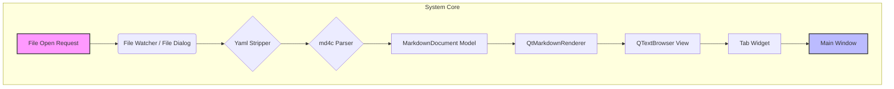

# التصور النهائي: MD Backpack Reader

## الهدف الأساسي (The Core Mission)

بناء **قارئ مستندات Markdown فائق السرعة والخفة** على أن يكون أداة مكافئة لـ "Notepad" لكن متخصصة في Markdown. الـ Focus ليس على التحرير، بل على **القراءة الفورية (Instant Readability)**.

### فلسفة العمل
- **الخفة المطلقة**: استهلاك ذاكرة لا يتجاوز 40-50 MB عند بدء التشغيل (مقارنة بـ 150-200 MB للمتصفحات).
- **السرعة اللحظية**: فتح الملفات بسرعة لا تُحس (Milliseconds) حتى مع الملفات الكبيرة.
- **التكامل العميق مع OS**: العمل كـ Default Application لملفات .md لتوفير تجربة مباشرة في فتح الملفات.

---

## التصور المعماري النهائي (System Architecture Vision)

### البنية التنظيمية (Organizational Structure)
```
md-backpack-reader/
|-- CMakeLists.txt              # نقطة البناء الرئيسية
|-- .clang-format               # التنسيق الموحد للأكواد
|-- .gitignore                  # قواعد git
|-- docs/                       # التوثيق والرسومات
|   |-- VISION.md               # هذا الملف
|   └── architecture/             # رسومات SVG للهيكلية
|-- assets/                      # الأصول والأيقونات والألوان
|   |-- icons/
|   |   |-- app-icon.ico         # Windows
|   |   |-- app-icon.icns        # macOS
|   |   └── app-icon.png         # Linux
|   |-- images/                  # لوضع تجارب الصور
|   |── style.css                # CSS لتنسيق Markdown (إذا لزم)
|   └── ...
|-- src/                         # المصدر الأساسي
|   |-- main.cpp                 # نقطة الدخول
|   |-- interfaces/              # الواجهات التجريدية (نقاط التوسع)
|   |   |-- ITabManager.h
|   |   |-- IDocumentProcessor.h
|   |   |-- IExtensionPoint.h
|   |   └── ISettingsProvider.h
|   |-- app/                     # طبقة الواجهة (Presentation Layer)
|   |   |-- MainWindow.h/.cpp
|   |   |-- TabWidget.h/.cpp
|   |   |-- MarkdownEditor.h/.cpp
|   |   ├── ShortcutManager.h/.cpp
|   |   └── StatusBar.h/.cpp
|   |-- models/                  # طبقة البيانات (Data Layer)
|   |   |-- MarkdownDocument.h/.cpp
|   |   └── DocumentHistory.h/.cpp
|   |-- parsers/                 # طبقة المعالجة (Processing Layer)
|   |   |-- IMarkdownParser.h
|   |   ├── md4cParser.h/.cpp     # التنفيذ
|   |   ├── YamlStripper.h/.cpp
|   |   └── GfmExtensions.h/.cpp  # لدعم الجداول وغيرها
|   |-- renderers/               # طبقة العرض (Rendering Layer)
|   |   |-- IDocumentRenderer.h
|   |   |-- QtMarkdownRenderer.h/.cpp
|   |   └── AsyncImageLoader.h/.cpp
|   |-- services/                # طبقة الخدمات (Services Layer)
|   |   |-- FileWatcher.h/.cpp    # متابعة تغييرات الملف (Reload)
|   |   ├── ThemeManager.h/.cpp   # إدارة الألوان (Dark/Light)
|   |   └── SettingsManager.h/.cpp  # إدارة الإعدادات (QSettings)
|-- tests/                       # اختبارات الوحدة والتكامل
|   |-- unit/
|   |   ├── parsers/
|   |   ├── models/
|   |   └── services/
|   |-- integration/
|   │   └── main_window_test.cpp
|   ├── CMakeLists.txt
|   └── data/                    # ملفات Markdown للاختبار
|       ├── simple.md
|       ├── complex.md
|       ├── tables.md
|       ├── code_blocks.md
|       ├── yaml_test.md
|       └── large_test.md
└── deployment/                   # أدوات النشر والتجميع
    |-- windows/
    |   |-- installer.iss          # Inno Setup Script
    |   └── register_extensions.bat
    |-- linux/
    |   ├── md-backpack-reader.desktop
    |   └── PKGBUILD               # Arch Linux
    └── macos/
        └── Info.plist
```

---

## خطوط النقل والعزل (Data Flow & Decoupling)



**العزل الصارم: أي مكون لا يعرف عن الآخر إلا عبر الواجهات (Interfaces).**

---

## قرارات التصميم الرئيسية (Key Technical Decisions)

### 1. نظام البناء: CMake + FetchContent
```cmake
include(FetchContent)
FetchContent_Declare(
    md4c
    GIT_REPOSITORY https://github.com/github/md4c.git
    GIT_TAG        master # أو commit hash محدد لضمان استقرار البناء
)
FetchContent_MakeAvailable(md4c)
```
- **الرفض القاطع لـ git submodules**: يتطلب خطوات إعداد يدوية.
- **الرفض القاطع لـ system packages**: لا يمكن الاعتماد على توفرها.

### 2. المعالج (Parser): md4c (Embedded)
- **لماذا md4c؟** الأداء الأعلى عالمياً، دعم CommonMark و GFM، واستخدامه من Qt6 نفسه.
- **العلاقة مع Qt**: `QTextDocument::setMarkdown()` تستخدمه. سنتجه مباشرة لضمان عدم فقدان الميزات.
- **ال альтерنатив المرjected:**
  - **maddy**: C++ كلاسيكي ولكن أقل صيانة ودعم.
  - **cmark**: أقوى ولكن أبطأ قليلاً.

### 3. طبقة العرض (Renderer): QTextBrowser + QTextDocument
- **القرار**: `QTextBrowser` مع خاصية `setMarkdown()`.
- **لماذا ليس QWebEngineView؟** استهلاك 150MB+ من الذاكرة مع إطلاق Chromium هو نقيض فكرة "الخفة المطلقة".
- **لماذا ليس QSyntaxHighlighter مخصص؟** إعادة اختراع عجلة عرض الجداول والصور والقوائم المتداخلة ستكون معقدة وعرضة للأخطاء (Reinventing the wheel).
- **الحل الوسط**: استخدام `QTextBrowser` يستفيد من كفاءة Qt الداخلية في عرض HTML (التي تُنتج من Markdown بواسطة md4c) مع الحفاظ على خفة الأداء.

### 4. عرض الصور: Async Loading + Lazy Loading (Hybrid)
- **الشروط الصارمة**:
  - **منع تام** لتحميل الصور عبر HTTP/HTTPS (مخاطر أمان + بطء).
  - **السماح فقط** للمسارات المطلقة أو النسبية داخل الملفات المحلية.
  - **التنفيذ**: `QtConcurrent` + `QImageReader` في خيط خلفي (Worker Thread).
  - **Lazy**: تحميل الصورة فقط عند دخولها في نطاق الرؤية (Viewport) باستخدام `QScrollArea`. تحجيمها (Downsampling) إلى `max-width: 100%` و `max-height: 600px` لتجنب استهلاك الذاكرة الهائل.

### 5. إدارة التبويبات (Tab Management)
- **الواجهة**: `QTabWidget` خفيفة.
- **تحسين الأداء**: إبقاء عدد محدود من التبويبات في الذاكرة (Max 5-10). عند اقتلاع تبويب:
  1. إرسال إشارة `deleteLater()` للمرئيات.
  2. تحرير `MarkdownDocument*`.
  3. تنظيف الذاكرة مباشرة.
- **الملاحظات (Future)**: تخزين أسماء الملفات فقط في قائمة انتظارية للوصول السريع.

### 6. إدارة الذاكرة (Memory Governance)
- **الهدف**: استهلاك أقل من 50 MB.
- **الآليات**:
  - **RAII (Resource Acquisition Is Initialization)**: إدارة الذاكرة تلقائياً باستخدام `std::unique_ptr` و `QSharedPointer`.
  - **تنظيف فوري**: عند غلق تبويب، يتم استدعاء destructors بشكل فوري.
  - **مراقبة**: استخدام `valgrind` / `address sanitizer` على Linux لاكتشاف أي تسريبات.

---

## خطة الرؤية لتجربة المستخدم (UX Vision)

### السيناريو الأساسي (The Golden Path)
1. المستخدم يضغط على ملف `README.md` في File Explorer.
2. التطبيق يفتح فوراً (<= 1 ثانية).
3. يُعرض المحتوى بشكل أنيق، مع الجداول المنقحة والكود الملون.
4. المستخدم يمكنه فتح ملفات أخرى في تبويبات جديدة.
5. عند الانتهاء، يغلق التطبيق ولا يترك أي أثر في الذاكرة.

### اختصارات لوحة المفاتيح (Shortcuts)
- `Ctrl + O`: فتح ملف.
- `Ctrl + W`: إغلاق التبويب الحالي.
- `Ctrl + T`: فتح تبويب جديد فارغ.
- `Ctrl + Tab`: التنقل بين التبويبات.
- `Ctrl + F`: فتح شريط البحث داخل الملف (مستقبلاً).

### التكامل مع OS (Deep Integration)
- **Windows**: تسجيل البرنامج كـ Default Application لـ `.md` عبر Registry Keys.
- **Linux**: إنشاء `.desktop` file مع MIME type `text/markdown`.
- **macOS**: إنشاء `Info.plist` وتعريف UTIs.

---

## خطة التنفيذية (Implementation Roadmap)

### المرحلة 1: MVP (Minimum Viable Product)
1.  **إعداد CMake و Qt**: بناء `CMakeLists.txt` مع `FetchContent` لـ `md4c`.
2.  **النواة الأساسية**: `main.cpp` يستقبل `argv` ويفتح الملف.
3.  **العرض الأولي**: `QTextBrowser` يعرض نص Markdown بسيط.
4.  **التبويبات`: إضافة `QTabWidget` مع القدرة على فتح أكثر من ملف.
5.  **اختصارات لوحة المفاتيح**: ربط `Ctrl+O` و `Ctrl+W`.
6.  **التكامل الأولي مع OS`: إضافة معالجة لـ `argv`.

### المرحلة 2: تطوير المعالج والعزل
1.  **دمج md4c**: ربط المكتبة واستبدال `setMarkdown()` بـ Parser مخصص يتعامل مع التنسيقات الأكثر تعقيداً.
2.  **YamlStripper`: إنشاء طبقة لتجاهل كتل YAML بدون عرضها.
3.  **نظام الواجهات**: إنشاء `ITabManager`, `IDocumentProcessor` بشكل كامل.
4.  **عزل الرندر**: نقل منطق الكتابة على `QTextBrowser` إلى `QtMarkdownRenderer`.

### المرحلة 3: تحسين الأداء والتكامل الكامل
1.  **Async Image Loading**: إضافة الخيوط الخلفية لعرض الصور المحلية.
2.  **Theme Engine**: إضافة Dark Mode / Light Mode.
3.  **Settings System**: حفظ الإعدادات والمفضلة.
4.  **Testing**: اختبارات الوحدة (Unit Tests) واختبارات التكامل.
5.  **Deployment**: إنشاء حزم التثبيت لـ Windows/Linux.

---

## قرارات الحوكمة (Governance Decisions)

- **اللغة**: C++17/20 (لضمان توافق Qt6).
- **Style Guide**: `clang-format` + سير عمل Google C++ Style.
- **التوثيق**: كل دالة/فئة تحتاج `doxygen` comments.
- **الاختبارات**: تغطية 80% للوحدات الحرجة (الـ Parser, الـ Models).
- **الإصدارات**: Semantic Versioning (1.0.0-MVP).

---

## المخرجات المتوقعة

1.  **ملف تنفيذي واحد**: لا توجد DLLs أو Dependencies خارجية (Static Linking).
2.  **سرعة قصوى**: فتح ملف 50MB في أقل من 1 ثانية.
3.  **خفة مطلقة**: استهلاك RAM لا يتجاوز الـ 50MB.
4.  **تكامل تام**: العمل كـ Default App لـ `.md`.
5.  **قابلية التوسع**: أدوات مستقبلية ستُضاف دون لمس الكود الأساسي.

---

(ملاحظة: هذه الوثيقة تعتبر "Single Source of Truth" للمشروع وسيتم تحديثها مع كل تغيير تقني كبير.)